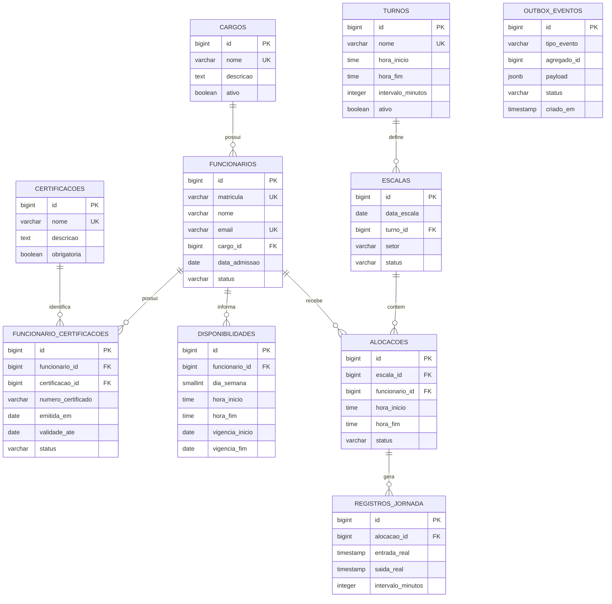

# DER — JornadaLog SIG 4.1 People

## 1. Objetivo

Este documento apresenta o Diagrama Entidade-Relacionamento (DER) do banco de dados RH_Jornada, desenvolvido em PostgreSQL 18.

O banco gerencia funcionários, cargos, certificações, disponibilidades, turnos, escalas e registros de jornada.

## 2. Diagrama Entidade-Relacionamento

## 3. Descrição dos relacionamentos

- Cargos e Funcionários: um cargo pode estar associado a vários funcionários.
- Funcionários e Certificações: relacionamento intermediado pela tabela funcionario_certificacoes.
- Funcionários e Disponibilidades: um funcionário pode possuir várias disponibilidades.
- Turnos e Escalas: um turno pode ser utilizado em várias escalas.
- Escalas e Alocações: uma escala pode conter várias alocações.
- Funcionários e Alocações: um funcionário pode possuir várias alocações.
- Alocações e Registros de Jornada: uma alocação pode possuir vários registros de jornada.

## 4. Tabela de eventos

A tabela outbox_eventos armazena eventos que serão enviados futuramente ao RabbitMQ. O campo agregado_id identifica o registro relacionado ao evento, sem possuir uma chave estrangeira direta.

## 5. SGBD

- Sistema gerenciador: PostgreSQL
- Versão: 18
- Banco de dados: RH_Jornada
